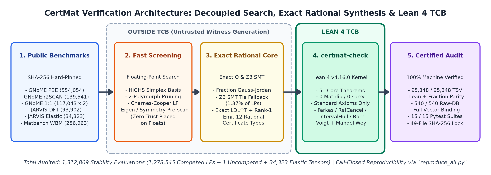
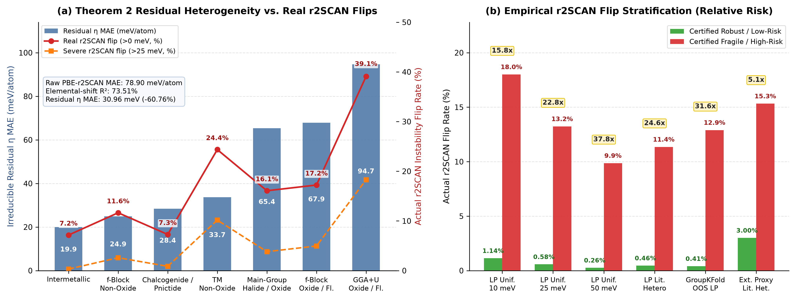
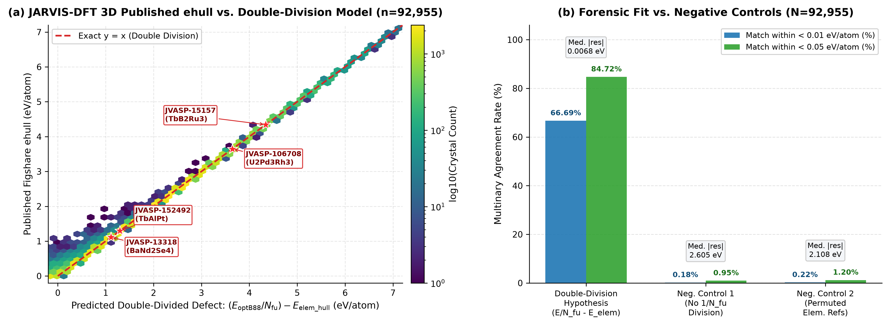
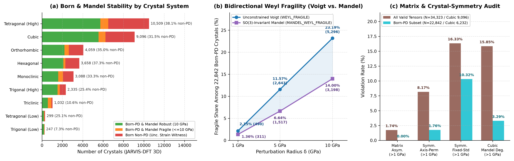
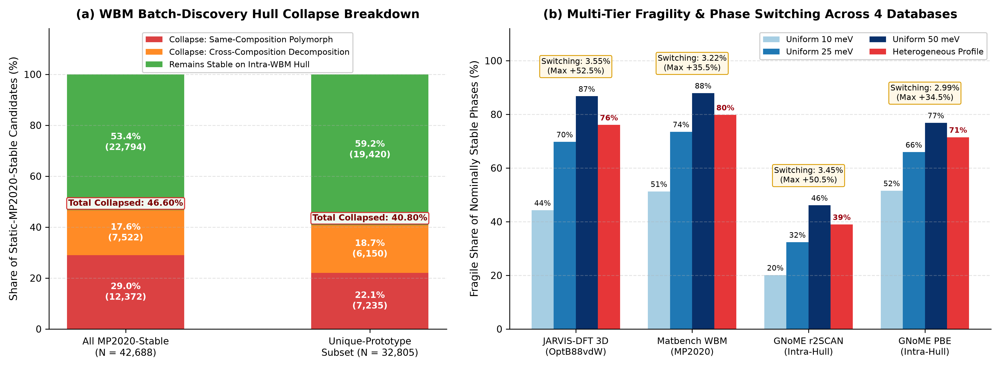

# CertMat: Certified Robust Phase and Elastic Stability Verifier

[-059669.svg)](lean/)
[](results/lean_verification_report.json)
[](results/)
[](tests/test_certmat.py)
[](LICENSE)

**CertMat** is an exact rational ($\mathbb{Q}$) certificate generator and machine-checked **Lean 4** formal verification kernel (`leanprover/lean4:v4.16.0`, zero Mathlib dependencies, zero `sorry` or non-standard axioms across **51 core theorems**) for auditing worst-case **thermodynamic phase stability** (convex hull) and **mechanical Born elastic stability** ($C \succ 0$) under DFT and MLIP prediction uncertainties.

Across **1,312,869 stability evaluations** spanning four public materials databases—**Google DeepMind GNoME** (PBE + r2SCAN), **NIST JARVIS-DFT 3D** (phase + 6x6 elastic), and **Matbench Discovery WBM**—CertMat decouples untrusted floating-point search from a self-contained Lean 4 Trusted Computing Base (TCB) and cross-verifies **95,348 / 95,348** serialized rational certificates with zero failures.



---

## Headline Empirical Findings

| Benchmark Database | Scope Audited | Key Certified Findings |
| :--- | ---: | :--- |
| **GNoME Matched PBE vs. r2SCAN** | 117,043 x 2 | **Theorem 2 validated**: correlated elemental shifts explain $R^2 = 73.51\%$ of discrepancy variance (MAE $78.90 \to 30.96$ meV/atom). Exact-LP Fragile flags separate real r2SCAN flips with **24.65x relative risk** (`0.46%` vs. `11.36%`, ROC-AUC `0.8948`; external `Decomp Energy` proxy **5.10x** RR, `96.40%` recall). |
| **GNoME PBE / r2SCAN Full** | 554,054 / 139,541 | **12,461 (2.99%)** PBE and **4,552 (3.45%)** r2SCAN nominally stable phases exhibit heterogeneous **Phase Switching** (59 / 27 critical Robust-to-Fragile reversals, up to `34.48%` / `50.52%` scale overestimation). |
| **NIST JARVIS-DFT 3D Phase** | 93,902 | **76.06%** of 25,908 ground states are fragile under heterogeneous intervals (`69.76%` at 25 meV; `75.36%` under $\sigma_{\text{elem}}=0$ ablation). **Upstream Data Integrity Discovery:** `63,386` entries in `jdft_3d-9-24-2025.json` have `ehull > 1.0 eV/atom` consistent with dividing per-atom `optb88vdw_total_energy` a second time by $N_{\text{fu}}$ (median residual `0.00677 eV` vs. `2.605` / `2.108 eV` negative controls). |
| **NIST JARVIS-DFT 3D Elastic** | 34,323 tensors | **11,481 (33.45%)** fail exact Born stability with Lean-verified rational strain counterexamples. Among 22,842 Born-PD crystals, **1,517 (6.64%)** are fragile under 5 GPa SO(3)-invariant Mandel perturbations (`2,643 / 11.57%` Voigt), with bidirectional Lean certificates (`MANDEL_WEYL_ROBUST` + `MANDEL_WEYL_FRAGILE`). **8.17%** (`2,805`) violate crystal-system symmetry even allowing VASP axis permutations. |
| **Matbench Discovery WBM** | 256,963 | **19,894 of 42,688 (46.60%)** static-MP2020-stable candidates collapse to strictly unstable under intra-WBM competition alone (`62.19%` same-composition polymorphs, `37.81%` cross-composition; `40.80%` after prototype deduplication). |

<p align="center">
  
  
</p>
<p align="center">
  
  
</p>

---

## Mechanized Lean 4 Kernel (51 Theorems, 0 `sorry`)

1. **Theorem 1 — Farkas Primal-Dual Soundness (`lean/CertMat/Farkas.lean`):** Non-negative decompositions $\lambda$ with $\sum_i \lambda_i E_i < E_x$ certify unconditional instability (`farkas_primal_unstable_excludes_dual`); chemical potentials $\mu$ with $\mu \cdot c_i \le E_i$, $E_x + \delta \le \mu \cdot c_x$, and enforced $\delta \ge 0$ certify universal stability (`checkDualStable_on_hull_sound`).
2. **Theorem 2 — Elemental Reference-Shift Cancellation (`lean/CertMat/RefErrorCancel.lean`):** Correlated elemental shifts $\sum_e c_{ie}\delta\mu_e$ cancel identically along every composition-conserving decomposition (`ref_error_exact_cancellation`); only uncorrelated residuals $\eta_i$ can flip phase stability (`only_residual_error_flips_stability`).
3. **Theorem 3 — Heterogeneous Interval Robustness & Phase Switching (`lean/CertMat/IntervalHull.lean`):** Worst-case corner certificates at $(U_x, L)$ and $(L_x, U)$ hold universally across the entire continuous uncertainty box (`interval_robust_stable_universal`, `interval_robust_unstable_universal`), paired with an exact Charnes-Cooper solver for $\varepsilon^*(x)$ and constructive `INTERVAL_FRAGILE_*` witnesses.
4. **Theorem 4 — Born $LDL^T$ & Bidirectional Voigt / SO(3)-Invariant Mandel Weyl Bounds (`lean/CertMat/BornElastic.lean`):** Exact rational $LDL^T$ positive-definiteness (`born_pd_of_ldlt`), constructive strain counterexamples (`not_born_pd_of_witness`), and bidirectional pure-rational (no irrational $\sqrt{2}$) SO(3)-invariant Mandel/Kelvin Frobenius-Weyl robustness and constructive rank-1 fragility theorems (`weighted_shifted_ldlt_frob_robust_born`, `weighted_weyl_fragile_of_witness`).

---

## Quickstart & One-Click Verification

```powershell
# 1. Verify all 4 datasets (SHA-256), Lean 4 build & 51 axioms,
#    95,348 TSV certificates, 540 raw-DB binding checks, 15 pytest suites, and 49-file manifest:
.venv\Scripts\python.exe reproduce_all.py --verify-only

# 2. Run unit, fuzzer, differential Lean-Python parity, and paper-consistency tests:
.venv\Scripts\python.exe -m pytest -v

# 3. Reproduce the JARVIS-DFT 3D published ehull double-division finding directly from raw JSON:
.venv\Scripts\python.exe scripts/repro_jarvis_ehull_bug.py

# 4. Regenerate all 5 publication figures (PNG 300 DPI + vector PDF):
.venv\Scripts\python.exe scripts/generate_figures.py

# 5. Full end-to-end recomputation from raw datasets (safe default: --workers 2):
.venv\Scripts\python.exe reproduce_all.py --full --workers 2
```

> **Note:** `reproduce_all.py --verify-only` checks the existing SHA-256-locked artifacts in `results/` against `lean/.lake/build/bin/certmat-check.exe` (approx. 85 seconds). Full recomputation across all 1.31M evaluations (`--full`) takes approx. 35-45 minutes with 12 workers or 1.5-2 hours with 2 workers.

---

## Repository Layout

```text
certmat/
├── lean/                      # Standalone Lean 4 v4.16.0 kernel (0 Mathlib, 0 sorry)
│   ├── CertMat/               # ExactRat, Farkas, RefErrorCancel, IntervalHull, BornElastic, Checker
│   └── Main.lean              # Compiled CLI checker (`certmat-check`) for 12 certificate types
├── certmat/                   # Exact rational (Fraction + HiGHS + Z3 SMT) Python verification engine
├── scripts/
│   ├── download_datasets.py   # Hard-pinned SHA-256 downloader for GNoME, JARVIS, and WBM
│   ├── run_full_audit.py      # Full 5-stage database audit and TSV certificate emitter
│   ├── run_supplementary_analysis.py # Elastic breakdown, zero-elem ablation, GroupKFold OOS CV
│   ├── generate_figures.py    # 300 DPI PNG + vector PDF figure generator
│   └── repro_jarvis_ehull_bug.py # Standalone JARVIS ehull double-division forensic script
├── paper/
│   ├── certmat_paper.md       # Full English manuscript with embedded figures & DOI references
│   ├── certmat_paper.tex      # Overleaf / arXiv / ChemRxiv-ready LaTeX manuscript
│   ├── references.bib         # Verified BibTeX bibliography (14 DOIs)
│   ├── certmat_summary_ko.md  # Korean executive summary report (한국어 요약 보고서)
│   ├── jarvis_issue_draft.md  # Ready-to-file GitHub issue draft for `usnistgov/jarvis`
│   └── figures/               # Publication-ready PNG (300 DPI) + vector PDF figures
├── results/                   # Summary JSONs, 95,348 TSV certificates, Lean & SHA-256 manifests
├── tests/test_certmat.py      # 15 comprehensive unit, differential, axiom & consistency tests
└── reproduce_all.py           # End-to-end fail-closed reproduction & verification orchestrator
```

---

## Documentation & Issue Report
- **Full Paper (Markdown & LaTeX):** [paper/certmat_paper.md](paper/certmat_paper.md) | [paper/certmat_paper.tex](paper/certmat_paper.tex) | [paper/references.bib](paper/references.bib)
- **Korean Summary Report (한국어 요약):** [paper/certmat_summary_ko.md](paper/certmat_summary_ko.md)
- **NIST JARVIS Upstream Bug Report Draft:** [paper/jarvis_issue_draft.md](paper/jarvis_issue_draft.md)

## License
Released under the [MIT License](LICENSE).
