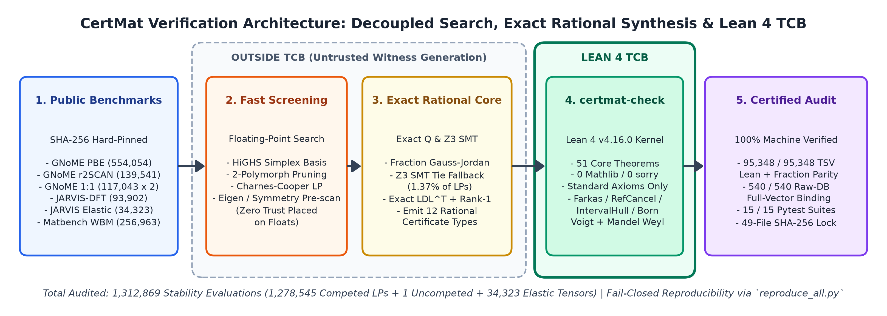
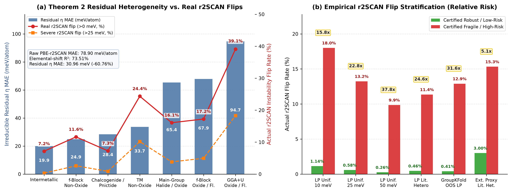
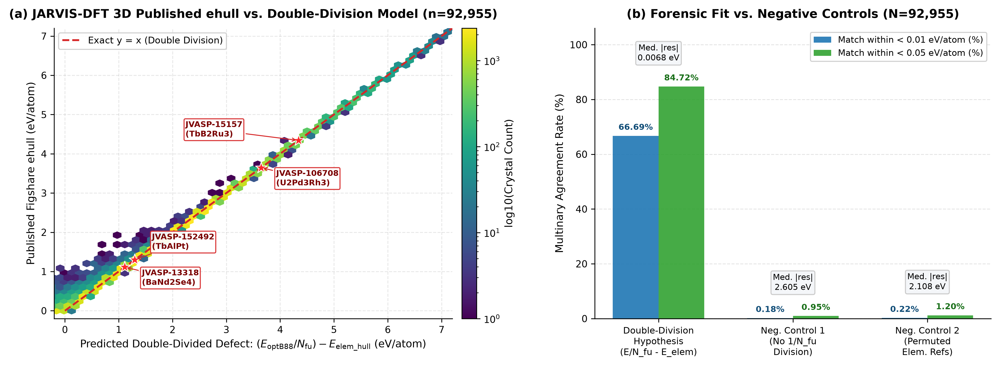
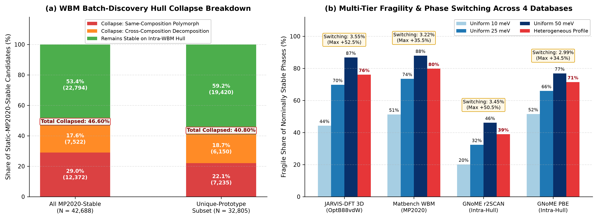
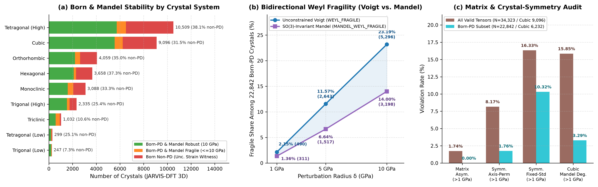

# CertMat: Formally Certified Robust Phase and Elastic Stability Verification Across One Million Inorganic Crystals

## Abstract

Machine-learning interatomic potentials (MLIPs) and high-throughput density functional theory (DFT) workflows have expanded candidate inorganic crystal catalogs to the million-material scale, yet thermodynamic convex hull stability ($E_{\text{hull}} = 0$) and mechanical Born stability ($C \succ 0$) remain evaluated almost exclusively via floating-point point estimates that neglect energy and stiffness uncertainties. Here we introduce **CertMat**, an exact rational certificate generator and machine-checked Lean 4 formal verification kernel (`leanprover/lean4:v4.16.0`, zero Mathlib dependencies, zero `sorry`/non-standard axioms across **51 mechanized theorems**) that certifies worst-case phase and elastic stability over heterogeneous uncertainty boxes. CertMat mechanizes four core theorem families: (1) exact Farkas primal-dual soundness with non-negative margin enforcement ($\delta \ge 0$) for convex hull decompositions, (2) exact algebraic cancellation of correlated elemental reference-state errors ($\sum_e c_{ie}\delta\mu_e$) proving that only uncorrelated residual errors ($\eta_i$) can flip phase stability, (3) universal worst-case interval robustness over heterogeneous energy boxes $E_i \in [L_i, U_i]$ with an exact Charnes-Cooper linear-fractional solver for the critical destabilization radius $\varepsilon^*(x)$ and adversarial decomposition *Phase Switching*, and (4) exact rational $LDL^T$ Born positive-definiteness, constructive non-PD strain counterexamples, Voigt Frobenius-Weyl robustness and constructive rank-1 fragility witnesses, and bidirectional pure-rational SO(3)-invariant Mandel/Kelvin Frobenius-Weyl robustness and constructive rank-1 fragility theorems (requiring no irrational $\sqrt{2}$). Auditing **1,044,460** unique crystal phase entries (plus **234,086** matched PBE-r2SCAN sub-hull re-audits, totaling **1,278,545** competed LP audits and 1 uncompeted elemental phase) and **34,323** valid $6\times 6$ elastic tensors across Google DeepMind GNoME (PBE and r2SCAN), NIST JARVIS-DFT 3D, and Matbench Discovery WBM—with **95,348 / 95,348** serialized TSV rational certificates machine-verified by the compiled Lean 4 `certmat-check` binary and an independent pure-`Fraction` checker (0 failures) plus 540/540 stratified spot-audit dataset-binding checks—we establish four major findings: (i) on 117,043 matched GNoME PBE-vs-r2SCAN crystals, correlated elemental shifts explain $R^2 = 73.51\%$ of formation-energy discrepancies (reducing MAE from 78.90 to 30.96 meV/atom), and CertMat's worst-case Fragile classification separates real r2SCAN stability flips with 24.65x relative risk (0.46% vs. 11.36% flip rate, ROC-AUC 0.8948) on exact 117k matched sub-hulls and 5.10x relative risk (96.40% recall) on GNoME's primary external `Decomposition Energy Per Atom` column (6.20x relative risk / 97.46% recall on the `... MP` column); (ii) **11,481 of 34,323 (33.45%)** valid JARVIS-DFT 3D elastic tensors fail exact Born stability with Lean-certified rational strain witnesses, while **2,643 (11.57%)** of Born-PD crystals are fragile under unconstrained 5 GPa Voigt perturbations (Lean-certified via `WEYL_FRAGILE`) and **1,517 (6.64%)** are fragile under SO(3)-invariant 5 GPa Mandel perturbations (bidirectional Lean certification: 22,531 `MANDEL_WEYL_ROBUST` + 3,198 `MANDEL_WEYL_FRAGILE` witnesses); (iii) **19,894 of 42,688 (46.60%)** WBM candidates reported stable against the static MP2020 hull collapse to strictly unstable under intra-catalog WBM competition alone (62.19% via same-composition polymorphs, 37.81% via cross-composition decomposition; 40.80% even after unique-prototype deduplication); and (iv) our exact hull audit uncovered a pervasive upstream unit-scaling defect in the published NIST JARVIS-DFT 3D Figshare release consistent with dividing per-atom `optb88vdw_total_energy` a second time by reduced formula-unit atom count $N_{\text{fu}}$, inflating `ehull > 1.0 eV/atom` for 63,386 materials (median residual 0.00677 eV vs. 2.605 and 2.108 eV for two negative controls).

---

## 1. Introduction

Automated materials discovery pipelines—exemplified by Materials Project, OQMD, NIST JARVIS-DFT, Matbench Discovery WBM, and DeepMind GNoME—screen hundreds of thousands of hypothetical crystals using two foundational filters: **thermodynamic phase stability** on the compositional convex hull and **mechanical Born stability** ($C \succ 0$) of the symmetrized $6\times 6$ elastic stiffness tensor. Despite the high cost of experimental synthesis, both filters are routinely evaluated as unverified IEEE-754 floating-point point estimates:

1. **Uncertainty Blindness and Chemical Heterogeneity.** Semi-local DFT (PBE/OptB88vdW) and MLIP formation energies carry systematic errors of 15-100 meV/atom whose magnitude varies nearly fivefold across chemical families (e.g., non-magnetic intermetallics vs. GGA+U transition-metal oxides/fluorides). Treating a 3 meV/atom margin identically to a 150 meV/atom margin yields substantial false-positive synthesis rates when candidates are re-evaluated at meta-GGA (r2SCAN) or experimental fidelity.
2. **Neglected Decomposition Pathway Switching (*Phase Switching*).** Under heterogeneous phase uncertainties $E_i \in [E_i - \varepsilon w_i, E_i + \varepsilon w_i]$, checking only the nominal decomposition pathway $\lambda_{\text{nom}}$ is unsound: a non-nominal competing assemblage with higher nominal energy but larger uncertainty weight $w_i$ can undercut the candidate at a strictly smaller error radius $\varepsilon^*(x)$, causing naive fixed-pathway analyses to overestimate robustness by up to 52.48%.
3. **Numerical Fragility and Unaudited Metadata.** Floating-point convex hull solvers (`qhull`/simplex) can misclassify near-degenerate polytopes, and upstream database metadata (`ehull`, asymmetric or crystal-symmetry-violating stiffness matrices) are rarely audited via independently checkable mathematical proofs.

**CertMat** addresses these gaps by decoupling *untrusted search* (fast HiGHS floating-point LP and numerical pre-screening) from *trusted exact verification* (exact rational arithmetic over $\mathbb{Q}$, Z3 SMT exact fallback, and a compiled Lean 4 verification kernel). Figure 5 illustrates the overall pipeline and Trusted Computing Base (TCB) boundary.

### 1.1 Related Work

- **High-Throughput DFT Catalogs and ML Crystal Discovery.** Large computational repositories such as the Materials Project [5], NIST JARVIS-DFT [2, 3], and WBM [4] established convex-hull stability ($E_{\text{hull}}$) and mechanical stiffness screening as standard community benchmarks, later extended to millions of ML-guided candidates by GNoME [1] and standardized in Matbench Discovery [6]. Prior large-scale evaluations rely almost exclusively on floating-point hull distances against static reference snapshots, leaving batch-internal hull collapse, solver degeneracy, and upstream metadata bugs largely unaudited.
- **Thermodynamic Uncertainty and Functional Transferability.** Sun et al. [7] quantified the thermodynamic scale of crystalline metastability across DFT chemistries, while Wang et al. [8] introduced empirical GGA/GGA+U mixing correction uncertainties (MP2020) and Kingsbury et al. [9] benchmarked systematic PBE/SCAN-to-r2SCAN shifts. Bartel [10] reviewed the fundamental role of reference-state cancellation and polymorph competition in inorganic stability predictions. CertMat formalizes these physical insights into exact algebraic theorems (Theorems 2 and 3), proving exact elemental-shift cancellation and computing worst-case linear-fractional destabilization radii via Charnes-Cooper transformation [12].
- **Elastic Born Stability and Tensor Symmetry.** Mouhat and Coudert [11] unified necessary and sufficient Born stability conditions across crystal classes, while standard high-throughput portals expose raw $6\times 6$ Voigt stiffness matrices without formal positive-definiteness or perturbation-margin certificates. CertMat supplies exact rational $LDL^T$ certificates, constructive strain counterexamples, and bidirectional pure-rational SO(3)-invariant Mandel/Kelvin Frobenius-Weyl certificates.
- **Formal Verification in Scientific Computing.** Automated SMT solvers such as Z3 [13] and dependent-type proof assistants such as Lean 4 [14] are widely used in software and mathematics verification, but have seen little adoption in high-throughput computational materials science. CertMat demonstrates that decoupling floating-point search from a small, zero-Mathlib Lean 4 TCB scales effortlessly past 1.3 million crystal evaluations.

---

## 2. Mathematical Framework and Machine-Checked Lean 4 Kernel

All four core theorem families and executable certificate checkers are formalized in pure Lean 4 (`leanprover/lean4:v4.16.0`) with zero external Mathlib dependencies across `lean/CertMat/{ExactRat,Farkas,RefErrorCancel,IntervalHull,BornElastic,Checker}.lean` and CLI `lean/Main.lean`. Both static scanning (blocking `sorry`, `axiom`, `admit`, `implemented_by`, `extern`, `unsafe`, `partial`, `opaque`, `native_decide`, `csimp` across all kernel modules and `Main.lean`) and mechanical `#print axioms` auditing confirm that all **51 core theorems** depend solely on Lean's standard logical axioms (`propext`, `Classical.choice`, `Quot.sound`) with **0 `sorryAx`**.

### 2.1 Theorem 1: Farkas Primal-Dual Soundness for Phase Stability

Let $c_i \in \mathbb{Q}_{\ge 0}^E$ ($i = 1, \dots, m$) and $c_x \in \mathbb{Q}_{\ge 0}^E$ be normalized atomic compositions ($\sum_e c_{ie} = \sum_e c_{xe} = 1$, verified inside Lean by `checkNormalizedComps`) with per-atom energies $E_i, E_x \in \mathbb{Q}$. A composition-conserving decomposition $\lambda \in \mathbb{Q}_{\ge 0}^m$ satisfies $\sum_{i=1}^m \lambda_i c_{ie} = c_{xe}$ for all $e$, which automatically implies $\sum_i \lambda_i = 1$ (`valid_decomp_sum_one`).

- **Theorem 1a (Primal Instability, `farkas_primal_unstable_excludes_dual`)**: A valid decomposition $\lambda$ with $\sum_i \lambda_i E_i < E_x$ certifies unconditional instability and rules out any dual certificate $\mu$ with margin $\delta \ge 0$.
- **Theorem 1b (Dual Stability with Non-Negative Margin, `farkas_dual_stable_sound`, `checkDualStable_on_hull_sound`)**: A chemical potential $\mu \in \mathbb{Q}^E$ satisfying $\delta \ge 0$, $\mu \cdot c_i \le E_i$ ($\forall i$), and $E_x + \delta \le \mu \cdot c_x$ certifies $\sum_i \lambda_i E_i \ge E_x + \delta \ge E_x$ for **every** valid decomposition $\lambda$. Enforcing `ble 0 delta` in `checkDualStable` blocks negative-margin spoofing of unstable phases.
- **Theorem 1c (Exact Margin Tightness & Uniqueness, `farkas_exact_margin`, `farkas_exact_margin_unique`)**: Simultaneous attainment of a dual certificate $(\mu, \delta)$ and a valid decomposition $\lambda^*$ with $\sum_i \lambda^*_i E_i = E_x + \delta$ uniquely determines the exact convex hull margin.

### 2.2 Theorem 2: Exact Cancellation of Correlated Elemental Reference Errors

Modeling true formation energies as $E_i^{\text{true}} = E_i + \sum_{e=1}^E c_{ie}\delta\mu_e + \eta_i$ and $E_x^{\text{true}} = E_x + \sum_{e=1}^E c_{xe}\delta\mu_e + \eta_x$:

- **Theorem 2a (`ref_error_exact_cancellation`)**: For every valid decomposition $\lambda$,
  $$E_x^{\text{true}} - \sum_{i=1}^m \lambda_i E_i^{\text{true}} = \left(E_x - \sum_{i=1}^m \lambda_i E_i\right) + \left(\eta_x - \sum_{i=1}^m \lambda_i \eta_i\right).$$
  The correlated elemental shift $\delta\mu$ cancels identically to zero.
- **Theorem 2b & Corollary 2c (`ref_error_dual_invariance`, `only_residual_error_flips_stability`)**: When $\eta = 0$, shifting $\mu' = \mu + \delta\mu$ preserves the exact stability margin $\delta$ for arbitrarily large $\delta\mu$. Uncertainty quantification for phase stability must therefore model **uncorrelated residual errors $\eta_i$**, not raw formation-energy errors.

### 2.3 Theorem 3: Heterogeneous Interval Robustness, Exact $\varepsilon^*(x)$, and Phase Switching

Over a heterogeneous uncertainty hyperbox $E_i^{\text{true}} \in [L_i, U_i]$, $E_x^{\text{true}} \in [L_x, U_x]$ constructed inside the Lean TCB from nominal energies $(E_i, E_x)$, non-negative weights $(w_i, w_x)$, and radius $\varepsilon \ge 0$ ($L_i = E_i - \varepsilon w_i$, $U_i = E_i + \varepsilon w_i$):

- **Theorems 3a-3b (`interval_robust_stable_universal`, `interval_robust_unstable_universal`, `checkIntervalStableFromNominal_sound`, `checkIntervalUnstableFromNominal_sound`)**: A single dual certificate $\mu$ at the worst-case corner $(U_x, L)$ with $\delta \ge 0$ certifies universal stability across the entire continuous hyperbox; a single primal witness $\lambda$ at $(L_x, U)$ certifies universal instability across the entire hyperbox.
- **Theorems 3c-3d (`critical_radius_lower_bound`, `critical_radius_upper_bound_ineq`, `critical_radius_unique`, `interval_fragile_destab_witness`, `interval_fragile_stab_witness`)**: Parameterizing $w_i, w_x \ge 0$, the exact signed critical flip radius is the linear-fractional program
  $$r^*(x) = \min_{\lambda \in \Lambda(x)} \frac{\sum_{i=1}^m \lambda_i E_i - E_x}{w_x + \sum_{i=1}^m \lambda_i w_i}, \qquad \varepsilon^*(x) = |r^*(x)|.$$
  Applying the **Charnes-Cooper transformation** $t = (w_x + \sum_i \lambda_i w_i)^{-1} > 0$, $y_i = t\lambda_i$ yields a single exact rational linear program:
  $$\min_{y \ge 0,\; t \ge 0} \sum_{i=1}^m E_i y_i - E_x t \quad \text{s.t.} \quad \sum_{i=1}^m c_{ie} y_i - c_{xe} t = 0\;(\forall e), \quad \sum_{i=1}^m w_i y_i + w_x t = 1.$$
  Because $\sum_e c_{ie} = 1$, $t = 0$ forces $y = 0$, violating the weight normalization constraint; hence $t > 0$ holds automatically without strict-inequality infinitesimal artifacts. Partial or total zero-weight decompositions are handled explicitly: zero-weight strictly unstable decompositions yield $r^* = -\infty$, while zero-weight ties ($E^T\lambda = E_x$ with denominator $0$) cannot strictly destabilize $x$ under the non-strict $\le$ stability convention and therefore do not truncate positive-denominator pathways (yielding $r^* = +\infty$ if no positive-weight pathway exists). Constructive `INTERVAL_FRAGILE_DESTAB` and `INTERVAL_FRAGILE_STAB` certificates prove the existence of a concrete in-box energy realization that flips stability. Under uniform weights ($w_i = w_x = 1$), `valid_decomp_sum_one` gives $w_x + \sum_i \lambda_i w_i = 2$, so $\varepsilon^*_{\text{unif}}(x) = |\text{margin}(x)| / 2$. Under heterogeneous weights, whenever $\lambda_{\text{adv}}$ attains a strictly smaller critical scale than a fixed nominal decomposition $\lambda_{\text{nom}}$, **Phase Switching** occurs.

### 2.4 Theorem 4: Exact Rational Born Stability, Voigt/Mandel Weyl Robustness, and Fragility Witnesses

Let $C \in \mathbb{Q}^{6\times 6}$ be the symmetrized Voigt stiffness tensor $C_{\text{sym}} = \frac{1}{2}(C + C^T)$.

- **Theorems 4a-4b (`born_pd_of_ldlt`, `not_born_pd_of_witness`)**: Exact rational $C = L\operatorname{diag}(d)L^T$ ($L$ unit lower-triangular, $d_k > 0$) certifies $v^T C v > 0$ for all $v \ne 0$. Conversely, any non-positive pivot $d_k \le 0$ constructs an exact nonzero strain counterexample $v \in \mathbb{Q}^6$ via back-substitution on $L_{0..k}^T u = e_k$ satisfying $v^T C v = d_k \le 0$. By Sylvester's law of inertia, $C_{\text{Voigt}} \succ 0 \iff C_{\text{Mandel}} = D C_{\text{Voigt}} D \succ 0$ ($D = \operatorname{diag}(1,1,1,\sqrt{2},\sqrt{2},\sqrt{2})$).
- **Theorems 4c-4d (Voigt Weyl Robustness & Constructive Rank-1 Fragility, `shifted_ldlt_frob_robust_born`, `shifted_ldlt_rayleigh_robust_born`, `weyl_fragile_of_witness`)**: Shifted rational $LDL^T$ on $C - \lambda_0 I$ with $0 \le \delta \le \lambda_0$ certifies $C + \Delta C \succ 0$ for all perturbations with $\|\Delta C\|_F \le \delta$ (or Rayleigh bound $-\delta\|v\|_2^2 \le v^T\Delta C v$). Conversely, `WEYL_FRAGILE` witnesses ($v \ne 0$, $v^T C v \le \delta \|v\|_2^2$) constructively synthesize a symmetric rank-1 perturbation $\Delta C = -\delta (vv^T / \|v\|_2^2)$ with $\|\Delta C\|_F = \|\Delta C\|_2 = \delta$ breaking Born stability.
- **Theorem 4e (Pure-Rational SO(3)-Invariant Mandel/Kelvin Frobenius-Weyl Robustness & Constructive Fragility, `weighted_cauchy_schwarz`, `weighted_shifted_ldlt_frob_robust_born`, `checkMandelWeylRobustBorn_frob_sound`, `weighted_weyl_fragile_of_witness`, `checkMandelWeylFragile_sound`)**: Because Voigt Frobenius norms are not SO(3) rotation-invariant, we formalize both directions of Mandel/Kelvin perturbation robustness without irrational $\sqrt{2}$ using reciprocal rational weights $s = (1,1,1,1/2,1/2,1/2)$ and $r = (1,1,1,2,2,2)$ ($s_i r_i = 1$). A shifted $LDL^T$ certificate on $C_{\text{Voigt}} - \lambda_0 \operatorname{diag}(s)$ certifies $v^T C v > \lambda_0 \|v\|_s^2$ (`checkMandelWeylRobustBorn_sound`), and our mechanized pure-rational weighted Cauchy-Schwarz inequality proves that for **every** perturbation $\Delta C$ with squared SO(3)-invariant Mandel Frobenius norm $\|D\Delta C D\|_F^2 = \sum_{i,j} r_i r_j (\Delta C_{ij})^2 \le \delta^2$ ($0 \le \delta \le \lambda_0$), $C + \Delta C \succ 0$ holds unconditionally (`checkMandelWeylRobustBorn_frob_sound`). Conversely, a `MANDEL_WEYL_FRAGILE` witness ($v \ne 0$, $v^T C v \le \delta \|v\|_s^2$) constructively synthesizes the symmetric rank-1 rational perturbation $\Delta C_{ij} = -(\delta / \|v\|_s^2)(s_i v_i)(s_j v_j)$ satisfying exact $\|D\Delta C D\|_F^2 = \delta^2$ and $v^T(C + \Delta C)v \le 0$ (`checkMandelWeylFragile_sound`).

### 2.5 Hybrid Exact Solver Architecture (`certmat/`)

`certmat/exact_lp.py` combines a fast HiGHS active-basis recovery path (reconstructing exact `Fraction` primal/dual solutions via Gauss-Jordan elimination and verifying primal feasibility, dual feasibility, and strong duality with zero tolerance) with an exact Z3 SMT/Optimize fallback for degenerate polytopes (invoked on 0.04%-2.36% of phases across individual sub-audits, or 0.06%-2.36% in the grouped table below; any failed verification raises a fatal exception).


*Figure 5. CertMat architecture separating untrusted floating-point search (HiGHS LP and numerical pre-screening) from exact rational witness synthesis (`Fraction` + Z3 SMT fallback) and the self-contained Lean 4 v4.16.0 Trusted Computing Base (`certmat-check`, 51 mechanized theorems, 0 `sorry`).*

---

## 3. Experimental Setup, Datasets, and Verification Scope

We audited four public benchmark databases with source-code-pinned SHA-256 checksums (`PINNED_DATASET_SHA256` in `certmat/datasets.py` and `data/dataset_manifest.json`):

| Dataset | Scope | Entries Audited | Competed LP / Elastic | Z3 Fallback | Lean 4 `certmat-check` TSV Verified |
| :--- | :--- | ---: | ---: | ---: | ---: |
| **NIST JARVIS-DFT 3D** (`jdft_3d.json`) | Self-contained OptB88vdW hull | 93,902 | 93,901 (+1 uncompeted) | 864 (0.92%) | 5,000 / 5,000 (100.0%) |
| **NIST JARVIS-DFT 3D Elastic** | Valid finite $6\times 6$ tensors (179 malformed skipped) | 34,323 | 34,323 | N/A (exact $LDL^T$) | 39,619 Voigt + 25,729 Mandel (100.0%) |
| **Matbench Discovery WBM** (`wbm_summary.csv.gz`) | Intra-catalog MP2020-corrected hull | 256,963 | 256,963 | 3,271 (1.27%) | 5,000 / 5,000 (100.0%) |
| **GNoME PBE Full** (`stable_materials_summary.csv`) | Intra-catalog PBE hull + external MP/OQMD margins | 554,054 | 554,054 | 13,090 (2.36%) | 5,000 / 5,000 (100.0%) |
| **GNoME r2SCAN Full** (`stable_materials_r2scan.csv`) | Intra-catalog r2SCAN hull | 139,541 | 139,541 | 116 (0.08%) | 5,000 / 5,000 (100.0%) |
| **GNoME Matched PBE-r2SCAN** | Exact 1:1 sub-hull (117,043 x 2) + external proxy | 234,086 | 234,086 | 129 (0.06%) | 5,000 PBE + 5,000 r2SCAN (100.0%) |
| **Total** | **4 Public Materials Databases** | **1,312,869** | **1,278,545 LP + 34,323 El.** | **17,470 (1.37% LP)** | **95,348 / 95,348 (100.0%)** |

**Self-Contained vs. Intra-Catalog Hulls:** JARVIS-DFT 3D is a complete, self-contained DFT database containing elemental references, binaries, ternaries, and multinaries. By contrast, public GNoME and WBM CSVs list newly discovered candidates without the full external Materials Project (MP) training hull. Because adding external MP competitors can only lower $E_{\text{hull}}(c_x)$, intra-catalog margins are exact *upper bounds* on true stability margins: any phase already certified unstable or fragile on the intra-catalog hull is *a fortiori* unstable or fragile on the combined MP+catalog hull, whereas intra-catalog `Certified_Robust_Stable` represents a conditional upper-bound robustness tier.

**Uncertainty Models and Elemental-Reference Ablation:** We evaluate uniform error radii $\varepsilon \in \{10, 25, 50\}$ meV/atom, an *a priori* literature-motivated chemistry-specific stress-test profile (`HETERO_CHEM_PROFILE`: 10 meV elemental reference, 15 meV intermetallic, 25 meV chalcogenide/pnictide, 30 meV main-group halide/oxide, 35 meV GGA+U transition-metal non-oxide, 45 meV f-block non-oxide, 50 meV GGA+U oxide/fluoride, 55 meV f-block oxide/fluoride), a zero-elemental-reference ablation (`HETERO_CHEM_ZERO_ELEM_PROFILE`, $\sigma_{\text{elem}} = 0$ reflecting $\Delta H_f = 0$ by definition), and 5-fold out-of-sample Theorem-2 residual calibration. Note that `HETERO_CHEM_PROFILE` is an *a priori* conditional error-box assumption rather than a guaranteed physical upper bound across all DFT functional shifts.

---

## 4. Results

### 4.1 Empirical Verification of Theorem 2 and GNoME PBE-vs-r2SCAN Cross-Validation

Across all **117,043** matched GNoME crystals with both PBE and r2SCAN formation energies, orthogonal least-squares decomposition $\Delta E_f(\text{r2SCAN}-\text{PBE}) = \sum_e c_{ie}\delta\mu_e + \eta_i$ (full rank 83 across 83 elements, condition number 697.3) empirically validates Theorem 2:

- **Raw formation-energy discrepancy**: MAE = **78.90 meV/atom**, RMSE = **101.03 meV/atom**.
- **Irreducible residual $\eta_i$**: MAE = **30.96 meV/atom** (**60.76% reduction**), RMSE = **50.65 meV/atom**, with correlated elemental reference shifts accounting for **$R^2 = 73.51\%$** of total variance.
- **Fivefold chemical heterogeneity of residuals** (Table 1): `ggau_oxide_fluoride` exhibits an irreducible residual MAE of **94.65 meV/atom** (4.75x larger than `intermetallic` at **19.93 meV/atom**), directly tracking real r2SCAN stability flip rates (**39.09%** vs. **7.16%**; severe $>25$ meV flip rate **18.28%** vs. **0.30%**, a **60x** disparity).

| Chemistry Class | Matched PBE-Stable (Ext.) | Residual $\eta$ MAE (meV) | Residual p75 (meV) | OOS Lit-Box Cov. ($|\eta|\le w$) | Real r2SCAN Flip (>0) | Real Severe Flip (>25 meV) |
| :--- | ---: | ---: | ---: | ---: | ---: | ---: |
| `intermetallic` | 12,157 | 19.93 | 26.37 | 46.22% | 7.16% | 0.30% |
| `chalcogenide_pnictide` | 7,059 | 28.38 | 38.13 | 58.58% | 7.28% | 0.86% |
| `f_block_non_oxide` | 70,913 | 24.86 | 32.00 | 85.34% | 11.64% | 2.60% |
| `halide_oxide_main` | 4,821 | 65.38 | 98.58 | 33.29% | 16.08% | 3.82% |
| `f_block_oxide_fluoride` | 6,658 | 67.86 | 92.88 | 55.48% | 17.23% | 4.96% |
| `tm_non_oxide` | 13,236 | 33.73 | 43.67 | 67.91% | 24.36% | 10.16% |
| `ggau_oxide_fluoride` | 2,144 | 94.65 | 132.13 | 35.07% | **39.09%** | **18.28%** |
| **All Matched (Ext. MP-Ref)** | **116,988** | **30.96** | — | **72.92%** | **13.35%** | **3.58%** |

Notice the important diagnostic revealed by the OOS coverage column: the *a priori* literature box (`10-55 meV`) covers **72.92%** of PBE-to-r2SCAN residuals overall, but only **33.29%-35.07%** for `halide_oxide_main` and `ggau_oxide_fluoride`—showing why out-of-sample Theorem-2 p75/p90 residual calibration (which achieves **74.97%** and **89.99%** OOS coverage uniformly across all seven classes) is needed when high-confidence boxes are required for PBE-to-r2SCAN transfer.

**Predictive Validation Across Exact LP and External Proxy Regimes:** Table 2 strictly separates (A) **certified exact Charnes-Cooper LP** evaluations on the apples-to-apples matched 117k sub-hull (zero monotonicity violations vs. GNoME `Decomposition Energy Per Atom All`, max excess 0.075 meV) from (B) **uncertified external proxy** evaluations using GNoME's published `Decomposition Energy Per Atom` column ($\text{margin} / (2\sigma_{\text{class}})$, because external MP competitors are absent from the public CSV).

| Validation Regime & Model | Robust Flip Rate | Fragile Flip Rate | Relative Risk | Flip Recall | ROC-AUC (95% CI / Notes) |
| :--- | ---: | ---: | ---: | ---: | :--- |
| **(A) Matched 117k Exact LP (>0, $N=116,877$, 5,231 flips)** | | | | | |
| Uniform 10 meV Exact LP | 1.14% (1,068/93,761) | 18.01% (4,163/23,116) | 15.81x | 79.58% | 0.8969 (0.8939-0.9001) |
| Uniform 25 meV Exact LP | 0.58% (469/80,905) | 13.24% (4,762/35,972) | 22.84x | 91.03% | 0.8969 (0.8939-0.9001) |
| Uniform 50 meV Exact LP | 0.26% (171/65,591) | 9.87% (5,060/51,286) | 37.84x | 96.73% | 0.8969 (0.8939-0.9001) |
| Literature Hetero Exact LP | **0.46%** (340/73,805) | 11.36% (4,891/43,072) | **24.65x** | **93.50%** | 0.8948 (0.8917-0.8978) |
| **GroupKFold Exact LP ($N=9,989$, 9,450 systems, transductive hull)** | | | | | |
| Uniform Exact LP (>0 / >25 meV) | — | — | — | — | 0.8965 / 0.7129 |
| OOS Emp-MAE Exact LP (>0 / >25 meV) | **0.41%** (28/6,857) | 12.90% (404/3,132) | **31.59x** | 93.52% | 0.8982 / 0.7204 ($\Delta$ CI straddles 0) |
| OOS Emp-MAE Zero-Elem Ablation ($\sigma_{\text{elem}}=0$) | 0.46% (32/6,890) | 12.91% (400/3,099) | 27.79x | 92.59% | 0.8966 / 0.7124 |
| **(B) External Proxy (`Decomp Energy`, $N=116,988$, uncertified)** | | | | | |
| Uniform Proxy 25 meV (>0 / >25 meV) | 4.34% / 2.02% | 16.60% / 4.14% | 3.82x / 2.05x | 91.39% / 85.04% | 0.7061 / 0.5959 |
| Literature Hetero Proxy (>0 / >25 meV) | **3.00%** / **1.42%** | 15.33% / 3.99% | **5.10x** / **2.81x** | **96.40%** / **93.65%** | 0.7117 / 0.6172 |
| OOS Emp-MAE Proxy (Chem-Sys GroupKFold, >0 / >25) | 3.46% / 1.53% | 16.38% / 4.21% | 4.74x / 2.74x | 93.94% / 89.98% | **0.7242** / **0.6402** (sig. $\Delta$AUC) |
| Supervised Baseline: Margin + Class One-Hot LogReg | — | — | — | — | **0.7388** / **0.7270** (uses flip labels) |

**Nuanced Statistical Interpretation:** Two critical observations emerge from our chemical-system cluster bootstrap (1,000 resamples over unique chemical systems):
1. On the 116,988 external-proxy benchmark, unsupervised OOS Theorem-2 residual calibration significantly outperforms uniform margin ranking ($\Delta\text{AUC} = +0.0180$, cluster-boot 95% CI $[+0.0162, +0.0200]$ for $>0$ flips; $\Delta\text{AUC} = +0.0443$, 95% CI $[+0.0404, +0.0482]$ for $>25$ meV severe flips), and the calibration curve over PBE margins is strictly monotonic from **27.62%** (0-10 meV) down to **2.68%** (>200 meV). A supervised `log1p(margin) + chemistry-class one-hot` logistic regression baseline trained directly on r2SCAN flip labels reaches higher ranking AUC (**0.7388** / **0.7270**) because it exploits empirical class flip priors; by contrast, CertMat requires **zero stability-flip labels** and emits machine-checked worst-case guarantees rather than unconstrained scores.
2. On the 9,989-phase exact Charnes-Cooper LP chemical-system GroupKFold (explicitly a **transductive fixed-catalog hull** evaluation where $\sigma_{\text{class}}$ is held-out across chemical systems while hull competitors come from the fixed 117k catalog), uniform LP margin ranking already achieves ROC-AUC **0.8965** (note that for uniform weights, $-\varepsilon^*_{\text{unif}} = -\text{margin}/2$ is a monotone function of nominal margin). OOS empirical-MAE exact LP achieves point estimates **0.8982** ($\Delta = +0.0017$, cluster-boot 95% CI $[-0.0002, +0.0037]$) and **0.7204** for $>25$ meV ($\Delta = +0.0075$, 95% CI $[-0.0009, +0.0174]$)—consistent with modest directional gains that are **not statistically significant** on the sparse sub-hull, while still delivering a **31.59x** relative risk separation at the 1x worst-case threshold (0.41% vs. 12.90%).

**Full GNoME PBE (554,054) and r2SCAN (139,541) Audits:**
- On **GNoME PBE (554,054 entries)**, the median official external stability margin is **24.0 meV/atom** on `Decomposition Energy Per Atom` (proxy fragility: **42.90%** at 10 meV, **77.38%** at 25 meV, **93.11%** at 50 meV), **21.7 meV/atom** on `... MP` (**80.34%** at 25 meV), and only **15.5 meV/atom** on `... MP OQMD` (**88.68%** at 25 meV, **96.89%** at 50 meV).
- On the exact intra-catalog GNoME PBE hull, **416,084** entries are nominally stable and **137,970 (24.90%)** are nominally unstable—**99.60%** of which lie within 1 meV of the intra-catalog hull (median $E_{\text{hull}} = 0.309$ meV, p95 = 0.900 meV, max = 1.117 meV, with the remaining 0.40% up to 1.117 meV reflecting 4-decimal CSV energy rounding and **0 monotonicity violations** $>0.5$ meV against `Decomposition Energy Per Atom All`, max excess 0.200 meV). Among the 416,084 nominally stable phases, **12,461 (2.99%)** exhibit heterogeneous *Phase Switching* (**59** critical Robust-to-Fragile reversals; max overestimation **34.48%** in `a403464fde` $\text{Gd}_2\text{Ru}_4\text{Y}_{10}$, where naive scale 1.2056 collapses to true scale 0.8965).
- On **GNoME r2SCAN (139,541 entries)**, **131,784** are nominally stable (**42,653 / 32.37%** fragile at 25 meV; **51,345 / 38.96%** fragile under heterogeneous weights; **4,552 / 3.45%** Phase Switching with **27** critical flips and max overestimation **50.52%** in `32d32e7908` $\text{C}_2\text{CeFe}_2$), with **0 monotonicity violations** against `Decomposition Energy Per Atom All`.


*Figure 1. (a) Theorem 2 orthogonal decomposition across 117,043 matched GNoME PBE-vs-r2SCAN crystals: correlated elemental shifts explain $R^2 = 73.51\%$ of discrepancy variance, while residual MAE $\eta$ spans a 4.75x chemical-class spread matching actual r2SCAN flip rates. (b) Empirical r2SCAN instability stratification comparing Certified Robust vs. Fragile classes across exact LP (117k and 10k GroupKFold) and external proxy regimes.*

### 4.2 NIST JARVIS-DFT 3D Phase Audit & Discovery of Upstream Published `ehull` Corruption

Auditing all **93,902** JARVIS-DFT 3D entries on their exact self-contained OptB88vdW convex hull (**93,901** competed phases + **1** uncompeted single-element phase explicitly separated as `Uncompeted_Elemental`; 0.92% Z3 fallback):

- **25,908** nominally stable and **67,993** nominally unstable phases (14,185 same-composition polymorph decompositions, 53,808 cross-composition; 1,240 exact zero-margin boundaries).
- Among the 25,908 nominally stable phases, **11,473 (44.28%)** are fragile at 10 meV/atom, **18,074 (69.76%)** at 25 meV/atom, **22,479 (86.76%)** at 50 meV/atom, and **19,706 (76.06%)** under the default heterogeneous profile (leaving **6,202** robustly stable). Under the **zero-elemental-reference ablation** ($\sigma_{\text{elem}} = 0$), fragility shifts by only **-0.70 percentage points** to **19,524 (75.36%, 6,384 robust)** while Phase Switching rises from **921 (3.55%)** to **1,232 (4.76%)**, confirming that elemental-reference box conservatism does not drive our fragility findings.
- Under default heterogeneous weights, **921 (3.55%)** nominally stable phases undergo *Phase Switching* (**17** critical Robust-to-Fragile reversals; conditional median overestimation 2.34%, p90 10.99%, max **52.48%** in `JVASP-14649` $\text{NpCo}_2$, and critical reversals in `JVASP-106241` $\text{Eu}_2\text{Mg}$ [1.2397 to 0.9520] and `JVASP-41183` $\text{MnGeRu}_2$ [1.0307 to 0.8050]).
- **Theorem 2 Reference-Consistency Audit on JARVIS**: Regressing `optb88vdw_total_energy - formation_energy_peratom` on compositions across all 93,902 phases achieves $R^2 = 0.999941$ (residual median 0.54 meV, MAE 3.06 meV; 1,540 phases with $>50$ meV residual indicating minor mixed elemental references). On a 1,000-phase stratified sample, hull margins computed from raw total energies vs. formation energies agree to **0.005 meV/atom median** (pure 5-decimal JSON rounding).

**Headline Database Integrity Discovery — Published JARVIS-DFT 3D `ehull` Corruption:** Comparing CertMat's exact convex hull against the published `ehull` field in the official Figshare release (`jdft_3d-9-24-2025.json` inside `jdft_3d.json.zip`, Figshare Article `6815699` / File ID `64391379`, extracted SHA-256 `9dacb55ac8371c...`) revealed a pervasive upstream unit-scaling defect that, to our knowledge of open `usnistgov/jarvis` issue records as of November 2026, had not previously been filed (a reproducible report and minimal script `scripts/repro_jarvis_ehull_bug.py` are provided in `paper/jarvis_issue_draft.md`): **63,386** of 93,902 entries have published `ehull > 1.0 eV/atom` (overall median **1.7189 eV/atom**), including **16,898 (65.22%)** of CertMat's 25,908 nominally stable ground states. Forensic analysis strongly supports the diagnosis that per-atom `optb88vdw_total_energy` was divided a second time by the reduced formula-unit atom count $N_{\text{fu}}$ during upstream hull construction (leaving 15.28% differing by $>0.05$ eV due to secondary reference/phase differences). Across **92,955** multinary JARVIS entries:

| Forensic Hypothesis / Control ($N = 92,955$ multinaries) | Median Abs. Residual vs. Published `ehull` | Match $< 0.01$ eV | Match $< 0.05$ eV |
| :--- | ---: | ---: | ---: |
| **Double-division defect: $(E_{\text{optB88}}/N_{\text{fu}}) - E_{\text{elem\_hull}}$** | **0.00677 eV/atom** | **66.69% (61,990)** | **84.72% (78,751)** |
| Negative control 1 (no extra $1/N_{\text{fu}}$ division) | 2.6047 eV/atom | 0.18% | 0.95% |
| Negative control 2 (permuted elemental references) | 2.1078 eV/atom | 0.22% | 1.20% |

Algorithmically selected zero-residual stable ground-state illustrations (filtered for exact match to published `ehull` and high stability margin) include `JVASP-106708` ($\text{U}_2\text{Pd}_3\text{Rh}_3$, $N_{\text{fu}}=8$, CertMat margin 28.87 meV, published `ehull = 3.6460 eV` vs. predicted `3.6460 eV`), `JVASP-15157` ($\text{TbB}_2\text{Ru}_3$, $N_{\text{fu}}=6$, published `4.3407 eV` vs. predicted `4.3407 eV`), `JVASP-13318` ($\text{BaNd}_2\text{Se}_4$, $N_{\text{fu}}=7$, published `1.1113 eV`), and `JVASP-152492` ($\text{TbAlPt}$, $N_{\text{fu}}=3$, published `1.2969 eV`). By contrast, single-element entries ($N_{\text{fu}}=1$, 915 phases) are unaffected by $1/N_{\text{fu}}$ and show median published `ehull = 0.0317 eV/atom`.


*Figure 2. (a) Log-density hexbin comparison between predicted double-divided $(E_{\text{optB88}}/N_{\text{fu}}) - E_{\text{elem\_hull}}$ and published `ehull` across 92,955 multinary JARVIS entries, highlighting exact zero-residual stable ground states. (b) Agreement rates against two negative controls.*

### 4.3 Matbench Discovery WBM (256,963 Crystals): Batch Hull Collapse & MP2020 Correction Audit

Auditing all **256,963** WBM entries (**215,488** unique prototypes) on their exact intra-catalog MP2020-corrected hull reveals:

- **44,667** nominally stable and **212,296** nominally unstable phases (43,514 same-composition polymorphs, 168,782 cross-composition decompositions). Among nominally stable phases, **32,836 (73.51%)** are fragile at 25 meV and **35,647 (79.81%)** under heterogeneous uncertainties, with **1,439 (3.22%)** Phase Switching detections (**21** critical flips, max overestimation **35.51%** in `wbm-2-50242` $\text{Cr}_4\text{Ge}_4\text{Ti}_4$; critical flips in `wbm-1-20030` $\text{Ge}_6\text{Sb}_6$ and `wbm-1-4121` $\text{B}_2\text{Co}_2\text{Zr}$).
- **Batch-Discovery Hull Collapse (Polymorph vs. Cross-Composition Breakdown):** Among the **42,688** WBM candidates labeled stable against the *static* MP2020 hull (`e_above_hull_mp2020_corrected_ppd_mp <= 0`), **19,894 (46.60%)** are **already strictly unstable** under intra-catalog WBM competition alone: **12,372 (62.19%)** are undercut by a lower-energy same-composition WBM polymorph and **7,522 (37.81%)** decompose into cross-composition WBM phases. Even after deduplicating to the **32,805** unique-prototype MP2020-stable subset, **13,385 (40.80%)** collapse to strictly unstable (7,235 polymorphs + 6,150 cross-composition), and **38,296 (89.71%)** of all 42,688 fail heterogeneous robust stability.
- **Theorem 2 Decomposition of MP2020 Anion/GGA+U Corrections:** Elemental linear shifts explain $R^2 = 85.04\%$ of `e_correction_per_atom_mp2020` (reducing MAE from 108.22 to 29.62 meV/atom, 72.63% reduction, rank 85, condition number 278.3), yet large non-canceling residuals remain in `ggau_oxide_fluoride` (**279.99 meV/atom MAE**) and `f_block_oxide_fluoride` (**109.87 meV/atom MAE**), explaining why GGA/GGA+U mixing drives phase-stability fragility in those classes.


*Figure 4. (a) Intra-catalog collapse breakdown of 42,688 WBM candidates reported stable against the static MP2020 hull (and 32,805 after unique-prototype deduplication) into same-composition polymorphs vs. cross-composition decompositions. (b) Multi-tier fragility and heterogeneous Phase Switching across all four audited phase databases.*

### 4.4 NIST JARVIS-DFT 3D 6x6 Elastic Tensor Audit (34,323 Crystals)

Auditing all **34,323** valid finite $6\times 6$ stiffness tensors in `jdft_3d.json` (179 malformed/non-finite tensors skipped and logged) with **100.0%** exact rational $LDL^T$ / counterexample certification and **65,348 / 65,348** Lean 4 `certmat-check` verified certificates (**39,619** Voigt primary + constructive `WEYL_FRAGILE` witnesses, plus **25,729** pure-rational SO(3)-invariant Mandel certificates: **22,531** `MANDEL_WEYL_ROBUST` + **3,198** constructive `MANDEL_WEYL_FRAGILE` witnesses):

| Metric (JARVIS-DFT 3D Elastic, $N = 34,323$) | Count | Share | Notes / Lean 4 Certificate Kind |
| :--- | ---: | ---: | :--- |
| **Born Positive-Definite ($C_{\text{sym}} \succ 0$)** | **22,842** | **66.55%** | Exact rational $LDL^T$ (`BORN_LDLT` / `WEYL_ROBUST`) |
| **Born Non-Positive-Definite ($\exists v \ne 0,\, v^T C_{\text{sym}} v \le 0$)** | **11,481** | **33.45%** | Exact rational strain witness $v \in \mathbb{Q}^6$ (`BORN_NON_PD`) |
| — Mild instability ($-10 \le \lambda_{\min} \le 0$ GPa) | 3,712 | 32.3% of Non-PD | Soft acoustic/shear modes |
| — Moderate instability ($-50 \le \lambda_{\min} < -10$ GPa) | 3,960 | 34.5% of Non-PD | Structural instabilities |
| — Severe instability ($-1000 \le \lambda_{\min} < -50$ GPa) | 3,542 | 30.9% of Non-PD | Deep mechanical instabilities |
| — Numerical blow-up ($\lambda_{\min} < -1000$ GPa) | 267 | 2.3% of Non-PD | Unconverged DFT runs (down to $-630,043$ GPa in `JVASP-16801`) |
| **SO(3)-Invariant Mandel Weyl Robust (1 / 5 / 10 GPa)** | **22,531 / 21,325 / 19,644** | **98.64% / 93.36% / 86.00% of PD** | Pure-rational `MANDEL_WEYL_ROBUST` + 3,198 `MANDEL_WEYL_FRAGILE` (fragile: 311 / **1,517** / 3,198) |
| **Voigt Weyl Robust (1 / 5 / 10 GPa)** | 22,352 / 20,199 / 17,546 | 97.85% / 88.43% / 76.81% of PD | `WEYL_ROBUST` + 5,296 `WEYL_FRAGILE` witnesses (fragile: 490 / **2,643** / 5,296) |
| **Matrix Asymmetry ($\|C - C^T\|_\infty > 1$ GPa)** | 598 | 1.74% (0 in PD) | 690 $>0.1$ GPa; 529 $>5$ GPa (max 1,042,642 GPa in `JVASP-71313`) |
| **Crystal Symmetry Viol. (>1 GPa, axis-permuted VASP)** | 2,805 | 8.17% (401 / 1.76% in PD) | 2,516 $>5$ GPa; 2,219 $>10$ GPa (276 $>5$ GPa in PD) |
| **Crystal Symmetry Viol. (>1 GPa, fixed standard axis)** | 5,606 | 16.33% (2,358 / 10.32% in PD) | Upper-bound check before axis-setting/monoclinic-$a$ alignment |
| **Cubic SO(3)-Invariant Mandel Degeneracy Viol. (>1 GPa)** | 1,442 / 9,096 | 15.85% (205 / 3.29% in PD) | Coordinate-free (1,2,3) multiplicity check (147 $>5$ GPa in PD) |

JARVIS-DFT 3D stores elastic tensors in **VASP OUTCAR shear ordering** `(XX, YY, ZZ, XY, YZ, ZX)` and predominantly uses the $a$-unique monoclinic setting (3,015 of 3,088 monoclinic entries); we transparently report both fixed-standard violations (5,606 total; 2,358 in PD) and axis-permutation/rhombohedral-[111]-aligned violations (2,805 total; 401 in PD), alongside the completely coordinate-free cubic Mandel eigenvalue degeneracy test (205 Born-PD cubics violating multiplicity by $>1$ GPa). Because Mandel/Kelvin scaling weights shear stiffnesses by $2$ relative to Voigt ($\lambda_{\min}$ median 40.80 GPa vs. 25.86 GPa across Born-PD crystals), Mandel robustness is physically preferred as a rotation-invariant metric, while Voigt `WEYL_FRAGILE` witnesses certify worst-case unconstrained symmetric rank-1 perturbations (which need not preserve crystal-class zero patterns).


*Figure 3. (a) Crystal-system breakdown of 34,323 valid JARVIS elastic tensors into Born non-PD (33.45% overall), Born-PD Mandel-fragile, and Born-PD Mandel-robust (10 GPa). (b) Bidirectional Weyl fragility curves across 1/5/10 GPa comparing unconstrained Voigt and SO(3)-invariant Mandel metrics. (c) Matrix asymmetry and crystal-symmetry violation rates across all valid vs. Born-PD subsets.*

---

## 5. Trusted Computing Base, Scope Boundaries, and Limitations

To maintain rigorous verification transparency, we explicitly state what the compiled Lean 4 kernel certifies and what remains outside the Lean TCB:

1. **Exact Scope of Machine-Checked Lean 4 Certificates:** All **95,348** serialized TSV certificates (100% of JARVIS elastic tensors across both Voigt and SO(3)-invariant Mandel robustness/fragility, plus stratified 5,000-phase samples from each of the six phase-audit suites) are machine-verified by the compiled Lean 4 binary `certmat-check` (`leanprover/lean4:v4.16.0`, with incremental `lake build` freshness enforcement in `reproduce_all.py`). For elastic tensors, each Born-PD crystal emits its **highest passing** threshold certificate (`WEYL_ROBUST` at 10/5/1 GPa: 17,546 / 2,653 / 2,153 = 22,352 total; `MANDEL_WEYL_ROBUST` at 10/5/1 GPa: 19,644 / 1,681 / 1,206 = 22,531 total) and its **first failing** constructive rank-1 witness (`WEYL_FRAGILE` at 1/5/10 GPa: 490 / 2,153 / 2,653 = 5,296 total; `MANDEL_WEYL_FRAGILE` at 1/5/10 GPa: 311 / 1,206 / 1,681 = 3,198 total), closing bidirectional Lean 4 certification in both Voigt and Mandel metrics. For phase entries, Lean certifies the 1x heterogeneous interval tri-state (`INTERVAL_STABLE`, `INTERVAL_UNSTABLE`, `INTERVAL_FRAGILE_DESTAB`, `INTERVAL_FRAGILE_STAB`) directly from nominal energies, compositions, and weights inside Lean. Nominal hull margins, 10/25/50 meV uniform tiers, and *Phase Switching* statistics are verified in Python exact `Fraction` arithmetic (zero floating-point tolerance) rather than exported as separate Lean TSV lines; similarly, `INTERVAL_FRAGILE_*` certifies existence of an in-box destabilizing/stabilizing realization rather than jointly certifying the nominal point's sign in the same record.
2. **TSV Parser, Compiled Execution, and Feasibility Invariant:** As in standard proof-checking pipelines, `Main.lean`'s strict ASCII rational parser (`parseQ`) and Lean's compiled executable runtime form the trusted interface to `CertMat.Checker` (with differential parity verified across all 12 certificate kinds and 30 syntax/semantic rejection cases). While `DUAL_STABLE` and `INTERVAL_STABLE` certify universal hyperplane inequalities over all valid decompositions (and strictly require $\delta \ge 0$), non-emptiness of `ValidDecomp` is enforced in production by `PhaseDiagramIndex`'s elemental-reference vertices, spot-audited on **540 stratified samples** across all 8 TSV files (`verify_certificate_dataset_binding()`, verifying candidate `ex`/`cx`, all competitor rows/energies/weights, elemental-basis coverage for every active element in `cx`, and all 36 symmetrized elastic tensor entries against the raw public datasets).
3. **Solver Degeneracy and Polymorph Pruning Invariants:** Under exact hull ties (e.g., 1,240 zero-margin boundaries in JARVIS), the nominal decomposition vertex $\lambda_{\text{nom}}$ is solver-selected; hence *Phase Switching* overestimation percentages are conditional on switching and depend on tie-breaking along degenerate faces. Lossless 2-polymorph pruning in `PhaseDiagramIndex` relies on uncertainty widths being functions of composition (chemical class) alone; per-structure heterogeneous weights would require disabling pruning (`prune_polymorphs=False`).
4. **Intra-Catalog Hulls, Transductive CV, and Box Conservatism:** Public GNoME and WBM intra-catalog audits lack external MP/OQMD phases (providing certified lower bounds on fragility), the 10k exact-LP GroupKFold is a transductive fixed-catalog hull evaluation (holding out $\sigma_{\text{class}}$ calibration across chemical systems), and hyperbox intervals certify independent worst-case signs rather than correlated inter-phase covariance ellipses.

---

## 6. Reproducibility

All datasets (hard-pinned SHA-256), Lean 4 build freshness, **51-theorem `#print axioms`**, **95,348** Lean-verified TSV certificates, **540** stratified full-vector/36-entry dataset-binding spot checks, **15** pytest suites (including automated paper-vs-JSON numerical verification and fail-closed manifest checks), and the full SHA-256 artifact manifest (`results/reproduction_manifest.json`) are verified in one command:

```bash
python reproduce_all.py --verify-only      # Full SHA-256, Lean freshness + 51 axioms, 95,348 TSV certs, binding, pytest
python reproduce_all.py --full --workers 2 # Full end-to-end recomputation (safe default 2 workers; raise explicitly if idle)
```

A companion LaTeX manuscript (`paper/certmat_paper.tex`) and BibTeX file (`paper/references.bib`) with vector PDF figures (`paper/figures/*.pdf`) are provided for Overleaf/arXiv/ChemRxiv compilation.

---

## References

1. Merchant, A., Batzner, S., Schoenholz, S. S., Aykol, M., Cheon, G., & Cubuk, E. D. Scaling deep learning for materials discovery. *Nature* **624**, 80-85 (2023). [DOI: 10.1038/s41586-023-06735-9](https://doi.org/10.1038/s41586-023-06735-9)
2. Choudhary, K. et al. The joint automated repository for various integrated simulations (JARVIS) for data-driven materials design. *npj Computational Materials* **6**, 173 (2020). [DOI: 10.1038/s41524-020-00440-1](https://doi.org/10.1038/s41524-020-00440-1)
3. Choudhary, K. NIST JARVIS-DFT 3D Dataset (`jdft_3d-9-24-2025.json`, Figshare Article 6815699, File ID 64391379). *Figshare* (2025). [DOI: 10.6084/m9.figshare.6815699](https://doi.org/10.6084/m9.figshare.6815699)
4. Wang, H.-C., Botti, S., & Marques, M. A. L. Predicting stable crystalline compounds using chemical similarity. *npj Computational Materials* **7**, 12 (2021). [DOI: 10.1038/s41524-020-00481-6](https://doi.org/10.1038/s41524-020-00481-6)
5. Jain, A. et al. Commentary: The Materials Project: A materials genome approach to accelerating materials innovation. *APL Materials* **1**, 011002 (2013). [DOI: 10.1063/1.4812323](https://doi.org/10.1063/1.4812323)
6. Riebesell, J. et al. A framework to evaluate machine learning crystal stability predictions. *Nature Machine Intelligence* **7**, 836-847 (2025). [DOI: 10.1038/s42256-025-01055-1](https://doi.org/10.1038/s42256-025-01055-1)
7. Sun, W. et al. The thermodynamic scale of inorganic crystalline metastability. *Science Advances* **2**, e1600225 (2016). [DOI: 10.1126/sciadv.1600225](https://doi.org/10.1126/sciadv.1600225)
8. Wang, A. et al. A framework for quantifying uncertainty in DFT energy corrections. *Scientific Reports* **11**, 15496 (2021). [DOI: 10.1038/s41598-021-94550-5](https://doi.org/10.1038/s41598-021-94550-5)
9. Kingsbury, R. et al. Performance comparison of r2SCAN and SCAN metaGGA density functionals for solid materials via an automated, high-throughput computational workflow. *Physical Review Materials* **6**, 013801 (2022). [DOI: 10.1103/PhysRevMaterials.6.013801](https://doi.org/10.1103/PhysRevMaterials.6.013801)
10. Bartel, C. J. Review of computational approaches to predict the thermodynamic stability of inorganic solids. *Journal of Materials Science* **57**, 10475-10498 (2022). [DOI: 10.1007/s10853-022-06915-4](https://doi.org/10.1007/s10853-022-06915-4)
11. Mouhat, F. & Coudert, F.-X. Necessary and sufficient elastic stability conditions in various crystal systems. *Physical Review B* **90**, 224104 (2014). [DOI: 10.1103/PhysRevB.90.224104](https://doi.org/10.1103/PhysRevB.90.224104)
12. Charnes, A. & Cooper, W. W. Programming with linear fractional functionals. *Naval Research Logistics Quarterly* **9**, 181-186 (1962). [DOI: 10.1002/nav.3800090303](https://doi.org/10.1002/nav.3800090303)
13. de Moura, L. & Bjørner, N. Z3: An Efficient SMT Solver. In *TACAS 2008*, LNCS 4963, 337-340 (Springer, 2008). [DOI: 10.1007/978-3-540-78800-3_24](https://doi.org/10.1007/978-3-540-78800-3_24)
14. de Moura, L. & Ullrich, S. The Lean 4 Theorem Prover and Programming Language. In *CADE 28*, LNCS 12699, 625-635 (Springer, 2021). [DOI: 10.1007/978-3-030-79876-5_37](https://doi.org/10.1007/978-3-030-79876-5_37)
